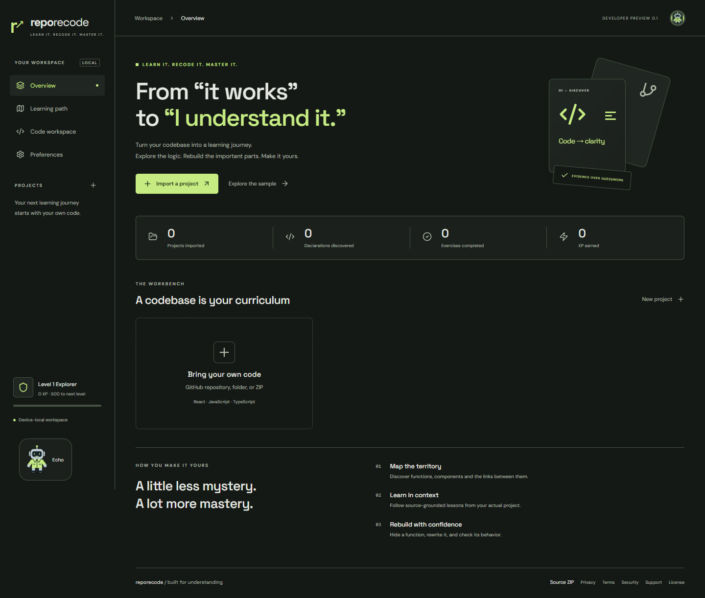
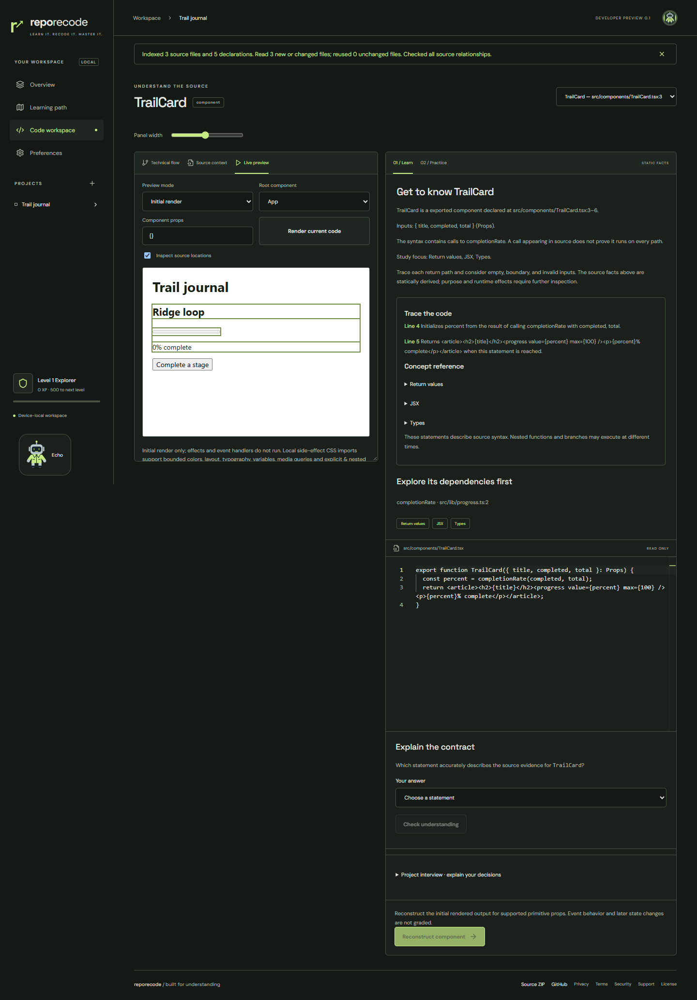

# RepoRecode

**Learn it. Recode it. Master it.** Learn your own source through walkthroughs, practice, inspection and verified feedback.

**Free-only development release 0.1.0.** Core learning needs no account, database or model. Optional accounts, private GitHub access and hosted operations need owner configuration and live acceptance. Paid model routes are removed. See [the current specification](docs/MASTER_SPEC.md) and [remaining work](docs/RESUME.md); the full specification is not yet complete.

[Open the public development site](https://repo-recode.vercel.app) · [Source on GitHub](https://github.com/abhiram0411/RepoRecode) · [Download the source](https://repo-recode.vercel.app/downloads/reporecode-source.zip)

Vercel Hobby and Supabase Free are connected. GitHub sign-in and single-account cloud project/preferences acceptance passed. Google, two-account isolation and hosted gateway features remain pending; see [setup status](docs/OWNER_NEXT_STEPS.md). The older Sites release remains available, with separate device-local storage.

## Start locally

Use Node.js 24 and npm.

~~~sh
npm ci --ignore-scripts
npm run dev
~~~

Open the printed local URL. Choose **Explore the sample** or import a public GitHub repository, folder or ZIP. Select a lesson, read its actual source, choose **Hide & rewrite**, then run checks. Incorrect solutions fail; equivalent solutions can pass. Drafts save automatically on this device.

~~~sh
npm test
npm run build
npm run preview
~~~

With Docker running, `npm run test:postgres` checks database concurrency using disposable synthetic data. `npm run test:docker -- --browser` builds and verifies the local app containers and browser journeys, then removes the test containers. See [container setup](docs/INSTALLATION.md#containers).

## Learning features

Local development and production builds both load the isolated runtime from its bundled WebAssembly asset. CI separately checks development-mode practice and interactive previews as well as the full production journey suite.

- Commit-pinned public GitHub import; bounded folder and ZIP import; optional GitHub App repository picker.
- TypeScript AST index with exact source locations, functions, components, methods, classes, interfaces, types, variables and architecture signals.
- Import, resolved call and JSX component graphs. Candidate database/auth/router signals are labelled as candidates.
- Personalized dependency-ordered lessons, source walkthroughs, concept definitions, quizzes, output prediction and saved interview reflections.
- Rewrite, missing-code, verified bug-fix and refactoring exercises. Numeric feature modifications and independent missions use a changed output contract.
- Component reconstruction compares actual isolated initial renders across up to six primitive-prop samples. Event behavior and later state are explicitly outside these checks.
- Monaco editing, type diagnostics, finite reference-derived probes and isolated QuickJS execution.
- Initial and interactive React previews, source inspection, state/effect updates, bounded observed function calls and practice edits with last-good-render preservation.
- Source-linked state reads from resolved React useState/useReducer imports, with bounded local value summaries and explicit render-order limits.
- Static state relationships connect resolved state bindings to reads, updater calls, initializers and JSX props, including up to two const-initializer steps in the same function. Numbered diagram arrows, a relationship picker and intermediate source links keep the evidence readable and distinct from runtime observations.
- Imported plain CSS renders through an allowlist in isolated previews, including bounded variables, layout and media queries. Omitted rules are disclosed. Optional device-theme following updates the workspace and editor without changing imported app colors.
- Local projects, backups, revalidated restoration, duplicate-snapshot recognition, progress, XP, achievements, mastery ranks and mission unlocks.
- Fifteen complete workspace palettes with matching Monaco and graphs, original distinct Boy/Girl/Robot artwork, independent cap/glasses, hair/clothes/body customization and reduced-motion-aware animation.
- Optional Supabase sign-in, identity linking, recovery, TOTP MFA, session sign-out controls, account deletion, project and preference sync.
- Silent Coding Pet reacts to practice and verified results. Source explanations, including bounded arithmetic/condition descriptions, remain in the main learning UI.
- Versioned learning-only progress export/import, exact-revision validation and duplicate-safe merges that preserve drafts and notes. Full-source backups remain separately labeled.
- Optional local feedback gateway, anonymous submissions, protected admin counts, and strictly opt-in anonymous activity with revocation. Without a gateway, visitors can review a public GitHub issue draft or copy their full feedback. GitHub requires an account; anonymous hosted delivery still needs a free backend. Unavailable counts are never invented.
- Protected administration, usage accounting, request history, deduplicated email/Telegram alerts and an independent uptime monitor.

## Supported boundaries

Analyze JS/TS/JSX/TSX and simple React source. Function practice accepts supported standalone synchronous functions and locally settled async functions with up to three explicitly typed parameters: scalars, bounded scalar literal unions (including null/undefined), scalar arrays, small fixed tuples and small nested objects. Named aliases, interfaces and concrete generic instantiations resolve through local imports and reexports, including bounded scalar/object constraints and earlier-parameter bounds. Generic functions with explicit scalar or small-object bounds, including earlier-parameter constraints are sampled within those bounds, with their original declarations type-checked. Objects allow two object levels, three scalar leaves and 16 samples, with independent variation required. Optional/default parameters and fields retain omitted/undefined/null distinctions. Deeper shapes, object array fields, wide unions, unbounded or self/forward-constrained generic functions, unresolved constrained wrappers, recursive or ambiguous types, rest parameters and nested arrays remain unsupported. Component reconstruction supports initial isolated renders for up to six primitive-prop samples, without full type checking or interaction grading. At most 64 finite function probes check sampled inputs, not general equivalence. Progress is motivational and client-authored, not a certificate.

Concrete generic practice supports aliases and interfaces with up to three unconstrained type parameters with explicit arguments or bounded defaults, including instantiated interface bases. Type arguments must expand into existing bounded input shapes. Generic functions, constrained type parameters, conditional/mapped types and recursive expansion remain unsupported. Read-only input type context preserves generic names and readonly fields.

Function grading settles native QuickJS promises and async/await results, with at most 1,000 microtask jobs and the existing 75 ms, 8 MiB and stack limits per probe. Promise chains, resolve/reject/catch and homogeneous Promise.all inputs work in the limited type environment. Timers, network and external dependencies remain unavailable. Pending reference promises make grading unsupported; rejected reference inputs are counted as excluded exception coverage. Grading compares settled outputs, not event-loop ordering or promise identity.

Older saved projects can refresh source analysis from Learning path without losing source, drafts, notes or progress. Identical reimports also refresh stale indexes. Prediction answers use typed comparison: object field order does not matter, while array order and value types do. Enter JSON or a top-level undefined, NaN, Infinity or -Infinity; compound outputs JSON cannot represent are not offered as prediction challenges.

React preview runs real React inside QuickJS. Choose **Interactive React**, render, then turn off **Inspect source locations** to use synchronous click, input, change and submit handlers. State, reducers and synchronous effects persist within the session. A bounded function-entry timeline links observed calls to source. Source or props changes require a fresh render; errors preserve the last working output. The frame cannot execute scripts.

This is a limited React runtime: DOM refs, timers, asynchronous handlers, navigation, arbitrary dependencies, network requests, external images and external stylesheets are unsupported. Plain local CSS must be imported for side effects. Explicit & nesting and media declarations support four combined block levels; implicit nesting and parser recovery text are omitted with notices. Default imports from local .module.css files expose up to 200 scoped class/ID names per file (100 characters per name). Composition, global module selectors, named/namespace CSS imports, animations and external fonts are unsupported. Loaded CSS is capped at 256 KiB with per-file limits; omitted rules/declarations are reported. Controlled forms use plain value/checked event data; full DOM event semantics and uncontrolled form persistence are not promised. State observations show up to 100 directly imported hook reads per action, including repeat renders and multiple instances, with bounded summaries. They are not a final state inventory, instance tracker, data-flow or network trace. The separate static state index traces const hook tuples and up to two const-initializer steps, with 200 relations in the list and 60 in the graph. React and the experimental reconciler are pinned together and require compatibility tests before upgrades.

Function probes vary every supported parameter before filling their 64-case budget. Comparison preserves missing/undefined/null distinctions and ignores plain object field insertion order. Unsupported callable or cyclic outputs cannot pass through JSON loss. Excluded reference inputs are reported; exception behavior is not graded.

Imports allow 200 source files, 128 KiB per file, 2 MiB total source and 5 MiB compressed ZIP. The browser holds at most 25 projects. Imported projects are never installed, modified or pushed back to their originals.

Consecutive imports reuse unchanged parsed files and declaration/call indexes for files unaffected by dependency changes. After a reload or worker restart, a compatible saved project can restore declaration/call indexes before a changed import. Old and new dependency graphs invalidate changed dependents; global declarations and truncated fact lists force a full rebuild. Compiler binding, state relationships and API candidates are recomputed. The worker retains only its most recent snapshot; restored source is parsed again because compiler objects are not persisted. Saved indexes stay inside existing project records, with no second source store. Old, malformed or oversized indexes fall back to fresh analysis. Identical snapshots resume saved work; changed snapshots remain separate projects. Linked-folder checks remain explicit or opt-in polling, not an operating-system watcher.

The API path index connects literal or constant root-relative fetch requests to declaration-resolved Express app/Router routes when method and path match exactly. Every connection is labelled a candidate: origins, router mounts, middleware, dynamic paths and actual delivery are not inferred. Shadowed fetch names, type-only/fake Express imports and ambiguous request methods are excluded. Limits are 200 combined sites, 200 candidate links and 60 diagram nodes. The source list and graph open the containing declaration, or a highlighted read-only source excerpt for top-level sites. Imported requests are never sent by this index. Paths and explicit method values can follow immutable string aliases, renamed imports/reexports, concatenation and string-only templates (eight expression levels, eight alias hops, 64 visits and 300 characters). Mutable bindings, type-only imports/reexports, object properties, calls and runtime interpolation remain excluded.

## Architecture

~~~mermaid
flowchart LR
  Source[GitHub folder or ZIP] --> Bounds[Import validation]
  Bounds --> Worker[TypeScript index worker]
  Worker --> Lessons[Source index and lessons]
  Lessons --> UI[React workspace]
  UI --> Local[(IndexedDB)]
  UI --> Eval[Disposable QuickJS workers]
  Eval --> Results[Practice results and React snapshots]
  UI -. explicit consent .-> API[Authenticated Node gateway]
  API -.-> Provider[No external AI provider]
  API -.-> Github[GitHub App]
  UI -. explicit sync .-> DB[(Supabase with RLS)]
  API -.-> DB
~~~

React and Vite keep the core portable without requiring a server. Monaco, React Flow, TypeScript, QuickJS, IndexedDB, Zod and parse5 provide the editor, analysis, execution, storage and validation. No unnecessary framework or server runtime is imposed on local learning.

## Documentation and release

- [Installation and self hosting](docs/INSTALLATION.md)
- [Service setup checklist](docs/SERVICE_SETUP.md)
- [Architecture and database](docs/ARCHITECTURE.md)
- [Architecture diagrams](docs/DIAGRAMS.md)
- [API inventory](docs/API.md)
- [Feature coverage](docs/FEATURES.md)
- [Full requirements audit](docs/REQUIREMENTS.md)
- [Verification and deployment status](docs/VERIFICATION.md)
- [Security](SECURITY.md), [contributing](CONTRIBUTING.md), [roadmap](ROADMAP.md)

The owner approved the MIT license. See LICENSE and THIRD_PARTY_NOTICES.md. No paid subscriptions or live AI calls were made during development. The public MIT source is available at https://github.com/abhiram0411/RepoRecode; its first GitHub-hosted CI run passed. Publication status and any verified website address are recorded in the verification document.

Keyboard access includes a skip-to-content link, focus movement after navigation, active page and mode announcements, and named source/practice editors. Profile options return focus to their trigger on Escape.

Default generic arguments resolve in declaration scope, including defaults referring to earlier parameters and defaults on inherited/imported interfaces. The read-only type context preserves defaults with imported type names expanded locally. Missing required arguments, forward/self references, invalid required-after-default ordering, constraints and shapes outside the existing bounds remain unsupported.

Linked folder refresh: on browsers offering the read-only directory picker, the Linked local folder panel retains a selected folder capability for the current page session. It can check manually or poll every 15 seconds while the tab is visible. Changes are shown before explicit import; each changed source snapshot uses the existing import flow, preserving the earlier project and progress separately. No file writes, cloud uploads, stored handles or background polling after reload. Permission errors stop polling. Hidden entries and dependency/build output are skipped; traversal is bounded to 5,000 entries/20 directory levels, with existing 200-file/128 KiB-per-file/2 MiB-total limits and a 10-second UI deadline. Browsers without the picker retain ordinary folder/ZIP import. This is polling, not an OS filesystem watcher. Separate index restoration can reuse compatible saved project analysis after reload.
