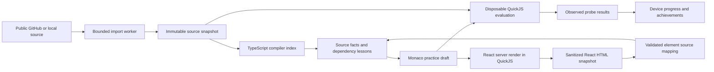
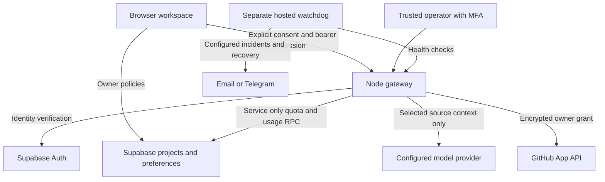

# Architecture diagrams

## Learning and evidence

Probe results cover finite cases. Initial React mode skips events/effects; interactive mode runs synchronous handlers, state and effects in QuickJS and replaces sanitized HTML. Parent listeners forward bounded event data; the frame cannot execute scripts. A separate function-entry timeline shows bounded VM observations. Static import, call and component edges remain static evidence.

## Optional connected services

The static public site does not host the Node gateway. Connected services need owner configuration and live acceptance. GitHub authorization state currently requires one gateway replica or sticky routing; automatic cross-device conflict merging is not implemented.
